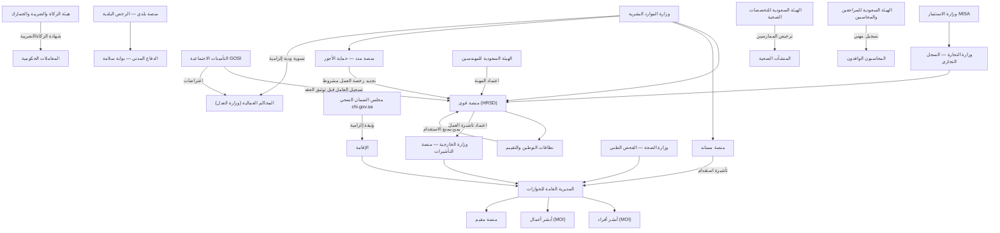

# دليل الجهات والمنصات — منظومة الإقامة والعمل والاستقدام في السعودية (المحور 1)

> **مشروع SAUDI-LABOR-INTEL-001** · تاريخ الاطلاع الموثّق لجميع مصادر هذا الدليل: **2026-11-17** (موافق 06/07/1448هـ).
> آخر تحديث للملف: 2026-11-17 · المعرفات: ENTITY-01..25 · REL-01..30 · SRC-01..30.

---

## 1) نطاق الدليل

يحدّد هذا الدليل الجهات الحكومية والمنصات الإلكترونية الرسمية التي تتكوّن عبرها منظومة العمل والإقامة والاستقدام للعمالة الوافدة في المملكة العربية السعودية: الاختصاص النظامي لكل جهة، منصتها الرسمية، المعاملات التي لا تُنجز إلا عبرها، وعلاقاتها الإجرائية بالجهات الأخرى (اشتراط متبادل / تبادل بيانات / تسلسل إجرائي). **يُميّز الدليل دائمًا بين الإجراء الرسمي الموثّق والممارسة الشائعة غير الموثّقة**، ويوسم كل ما لم يتحقق بعبارة "غير متحقق حتى الآن".

ملاحظة توثيقية: أداة `web_search` كانت معطلة أثناء البحث (خطأ إعداد 404)، فاستُخدم البديل: جلب مباشر للمواقع الرسمية + بحث DuckDuckGo HTML كأداة اكتشاف فقط؛ كل الأحكام النظامية أسندت إلى صفحات رسمية قُبِل جلبها أو ظهر نصها في نتائج البحث.

## 2) مصطلحات أساسية

| المصطلح | المعنى التنظيمي | الجهة المالكة للقرار/الوثيقة |
| --- | --- | --- |
| تأشيرة العمل | تصريح دخول للعمل، يُصدر بعد اعتماد من منظومة العمل | الموارد البشرية/قوى + الجوازات + الخارجية (منصة التأشيرات) |
| الإقامة (الإقامة النظامية/Iqama) | وثيقة البقاء النظامي للمقيم؛ تُصدر وتُجدد إلكترونيًا | المديرية العامة للجوازات (أبشر/مقيم) |
| رخصة العمل | تصريح ممارسة العمل لرب العمل تجاه العامل الوافد، تجديدها دوري | الموارد البشرية عبر قوى |
| تصريح النشاط/الاستقدام | تصريح يفتح للمنشأة الحق في استقدام أو نقل عمالة وفق نطاقها | الموارد البشرية/قوى |
| الكفالة ونقل الخدمات | ربط العامل برب العمل وانتقال الرعاية بين الكفيلين | الجوازات (أبشر أعمال/مقيم) بعد اشتراطات الموارد البشرية |
| نطاقات (التوطين) | تصنيف لوني للمنشآت وفق نسبة التوطين يؤثر في الاستقدام والنقل | الموارد البشرية (تُعرض على قوى) |
| حماية الأجور | نظام إثبات دفع الأجور عبر القنوات المصرفية (ملف WPS شهري) | الموارد البشرية — الواجهة الرسمية: منصة مدد |
| توثيق العقد | اعتماد عقد العمل إلكترونيًا بواسطة الطرفين | قوى (قرار مجلس الوزراء المنقول في خبر HRSD) |
| رخصة السلامة | شهادة مطابقة اشتراطات الدفاع المدني للمنشأة | الدفاع المدني (بوابة سلامة) |

## 3) الهيئة العامة للمنظومة (قراءة إجرائية)

السلسلة الرسمية النموذجية لوافد عمل: **سجل تجاري (وزارة التجارة) → تسجيل المنشأة في قوى → رخصة عمل أولية + تصريح استقدام وفق النطاق (قوى) → اعتماد تأشيرة العمل وارسالها إلى منصة التأشيرات/الجوازات (قوى ← الخارجية ← الجوازات) → دخول العامل → فحص طبي ووثيقة ضمان صحي → إصدار الإقامة (الجوازات/مقيم) → توثيق العقد في قوى + تسجيل العامل في التأمينات → تجديد رخصة العمل مشروطًا بالالتزام بحماية الأجور (مدد) والضمان الصحي والتأمينات**. العمالة المنزلية تسلك مسارًا موازيًا عبر مساند وفق لائحة العمالة المنزلية، وخارج نطاق نظام العمل الجزئي للعمالة المنزلية.

## 4) أقسام تفصيلية بمعرفات ENTITY

### 4.1 نواة تنظيم العمل والاستقدام

| ID | الجهة/المنصة | الاختصاص والسند | المنصة الرسمية (رابط) | معاملات لا تُنجز إلا عبرها | حالة |
| --- | --- | --- | --- | --- | --- |
| ENTITY-01 | وزارة الموارد البشرية والتنمية الاجتماعية (HRSD) | صاحبة اختصاص منظومة العمل، نظام العمل ولائحة العمالة المنزلية، الرقابة والتفتيش والتسويات | بوابة الوزارة: https://www.hrsd.gov.sa | الشكاوى والبلاغات (صفحة المستفيد)، التسوية الودية للخلافات العمالية، حاسبة نطاقات، إصدار القرارات التنظيمية | ساري — SRC-01..07 |
| ENTITY-02 | منصة قوى (Qiwa) | المنصة الموحدة لخدمات منظومة العمل (تعريف HRSD الرسمي): منشآت، أفراد، جهات | https://www.qiwa.sa | رخص العمل وتجديدها، اعتماد/توثيق عقود العمل للسعوديين وغير السعوديين (منصّة الاعتماد الرسمية وفق قرار مجلس الوزراء المنقول في خبر HRSD المركزي)، تصريحات الاستقدام والنقل، التقييم الموحد | ساري — SRC-02، SRC-04 |
| ENTITY-13 | منصة مساند (Musaned) | منظومة الاستقدام والعمالة المنزلية ومثيلاتها (طلبات الاستقدام، العقود، التأمين، النقل) | https://musaned.gov.sa | طلبات استقدام العمالة المنزلية وخدمات العمالة المساندة | ساري (تفاصيل الخدمات داخل المنصة SPA — قابلة للتحقق داخل الحساب) — SRC-09 |
| ENTITY-18 | جهات تصنيف المنشآت ونطاقات التوطين | برنامج نطاقات: تصنيف لوني للمنشآت (بلاتيني/أخضر بدرجاته/أحمر) وفق نسبة التوطين والحجم والنشاط؛ يتحكم في إتاحة الاستقدام والنقل | دليل إجرائي رسمي + حاسبة نطاقات عبر HRSD (SRC-05، SRC-06) | حساب النطاق وتأثيره يظهر ضمن ملف المنشأة في قوى | ساري (النسب المعيارية داخل دليل HRSD — لم تُنقل هنا تجنبًا للاختلاق) |
| ENTITY-20 | منصة مدد (Mudad) | "الواجهة الرسمية لبرنامج حماية الأجور" (نص HRSD الرسمي): إثبات دفع الأجور، إدارة الرواتب، نظام الالتزام | https://mudad.com.sa | رفع ملفات حماية الأجور (WPS) شهريًا للمنشآت | ساري — SRC-08 (مشغّل المنصة المزعوم "شركة السعودي الأول": غير متحقق حتى الآن) |

ملاحظات: (1) خبر HRSD المركزي (SRC-04) ينص على أن اعتماد وتوثيق عقود العمل للسعوديين وغير السعوديين يكون عبر قوى تطبيقًا لقرار مجلس الوزراء. (2) منصة العمل المرن (mrn.sa) منصة رسمية موازية للأعمال بالساعة للسعوديين (SRC-07). (3) منصة مسار (masar.sa) خاصة بالموارد البشرية الحكومية لا بالقطاع الخاص (SRC-07).

### 4.2 نواة الجوازات والإقامة (وزارة الداخلية)

| ID | الجهة/المنصة | الاختصاص والسند | المنصة الرسمية (رابط) | معاملات لا تُنجز إلا عبرها | حالة |
| --- | --- | --- | --- | --- | --- |
| ENTITY-03 | المديرية العامة للجوازات (GDP) | تطبيق نظام الإقامة ونظام وثائق السفر، إصدار التأشيرات والإقامات والخروج والعودة | https://www.gdp.gov.sa (قسم النظامية: نظام الإقامة، الخدمات الإلكترونية، الرسوم) | القرار الأصلي في إصدار/تجديد الإقامة وتأشيرات الخروج والعودة وإلغائها | ساري — SRC-10 |
| ENTITY-04 | منصة أبشر أفراد | بوابة وزارة الداخلية للأفراد (مواطنين، مقيمين، زوار) | https://www.absher.sa | خدمات المقيم الفردية: تجديد الإقامة، خروج وعودة، تصحيح أوضاع، موافقة نقل الخدمات | ساري — SRC-11 |
| ENTITY-05 | منصة أبشر أعمال | البوابة القطاعية لوزارة الداخلية للمنشآت (بوابة أعمال داخل أبشر) | https://www.absher.sa/wps/portal/business/ | إدارة عمالة المنشأة جوازيًا: نقل الخدمات بين الكفيلين، خروج وعودة جماعي، إقامات، تعديل بيانات | ساري — SRC-11، SRC-12 |
| ENTITY-06 | منصة مقيم (Muqeem) | منصة معاملات الجوازات للمنشآت تابعة لمنظومة الجوازات | https://muqeem.sa + بوابة التحقق من التأشيرات: https://vv.muqeem.sa | معاملات إقامة/خروج وعودة جماعية للمنشآت، والتحقق العلني من صلاحية تأشيرة الخروج والعودة والزيارة | ساري — SRC-13، SRC-14 (اسم المشغّل التجاري: غير متحقق حتى الآن) |
| ENTITY-07 | وزارة الداخلية (MOI) | الجهة الأم لمنظومة الجوازات والأمن الوطني | https://www.moi.gov.sa | السياسات العليا؛ الخدمات العملية تُقدم عبر أبشر/أبشر أعمال/مقيم | ساري — SRC-11 |
| ENTITY-24 | مكاتب الجوازات في المجمعات التجارية | قنوات حضورية مساندة للجوازات (المسمى المدقق من موقع الجوازات الرسمي) | صفحة "Passport offices in shopping centers" على gdp.gov.sa (SRC-10) | استقبال بعض المعاملات حضورًا | ساري — المسمى "مجمع الأعمال الجوازي" **غير متحقق حتى الآن** (لا يظهر بهذا الاسم في أي مصدر رسمي أو بحثي) |

### 4.3 التأشيرات، الصحة، والضمان

| ID | الجهة/المنصة | الاختصاص والسند | المنصة الرسمية (رابط) | معاملات لا تُنجز إلا عبرها | حالة |
| --- | --- | --- | --- | --- | --- |
| ENTITY-08 | وزارة الخارجية — منصة التأشيرات | إصدار التأشيرات واعتمادها للجهات والأفراد | https://visa.mofa.gov.sa (خدمات: الزوار/المواطنين والمقيمين/الأعمال والجهات) + النسخة التجريبية الموحدة https://ksavisa.sa | طباعة واعتماد التأشيرات ومتابعة الطلبات برقم السجل | ساري — SRC-15، SRC-16 |
| ENTITY-09 | وزارة الصحة (MOH) | الفحص الطبي للوافدين وشروط اللياقة الصحية | https://www.moh.gov.sa | الفحص الطبي الإلزامي قبل إصدار/تجديد الإقامة (حجز المواعيد إلكترونيًا وفق خبر مشترك HRSD/MOH) | ساري — SRC-17 |
| ENTITY-10 | مجلس الضمان الصحي (مجلس الضمان الصحي / CHI) | جهة حكومية مستقلة تأسست بقرار مجلس الوزراء رقم (71) وتاريخ 27/4/1420هـ (11/8/1999م)؛ تنظيم الضمان الصحي وإلزام رب العمل بوثائق التأمين للمقيمين | **البوابة الفعلية: https://www.chi.gov.sa** (الرقم الموحد 19977) | وثيقة الضمان الصحي شرط لإصدار/تجديد الإقامة؛ الاستعلام عن التأمين | ساري — SRC-18، SRC-19 (المعطى في تكليف "chs.gov.sa/CHS" **غير صحيح حاليًا**؛ النطاق الفعلي chi.gov.sa) |
| ENTITY-11 | المؤسسة العامة للتأمينات الاجتماعية (GOSI) | تطبيق نظام التأمينات الاجتماعية ونظام مخاطر العمل على المنشآت وعمالها (سعوديين ووافدين) | https://www.gosi.gov.sa (التأمينات أون لاين) + خدمة "تسجيل العاملين غير السعوديين": https://www.gosi.gov.sa/GOSIOnline/nonsaudireg | تسجيل المنشأة والعامل (إلزامي)، احتساب واشتراط الاشتراكات قبل مصادقة العقود في قوى | ساري — SRC-20، SRC-21 |
| ENTITY-22 | المديرية العامة للدفاع المدني | اشتراطات السلامة ورخصة السلامة للمنشآت | بوابة سلامة: https://998.gov.sa + https://salamah.998.gov.sa | إصدار/تجديد رخصة سلامة إلكترونيًا للمنشآت ذات السجل التجاري الساري | ساري — SRC-22 |

### 4.4 الامتثال المالي والتجاري والتأسيسي

| ID | الجهة/المنصة | الاختصاص والسند | المنصة الرسمية (رابط) | معاملات لا تُنجز إلا عبرها | حالة |
| --- | --- | --- | --- | --- | --- |
| ENTITY-12 | هيئة الزكاة والضريبة والجمارك (ZATCA) | الزكاة والضرائب (VAT) والجمارك والفوترة | https://zatca.gov.sa | شهادة الزكاة/الضريبة: خدمة "طلب شهادة الزكاة أو الضريبة" و"الطباعة الفورية لشهادة الزكاة" (تُطلب في كثير من المعاملات الحكومية والتعاقدية) | ساري — SRC-23، SRC-24 |
| ENTITY-19 | وزارة الاستثمار (MISA) | ترخيص الاستثمار الأجنبي وخدمات المستثمر | https://misa.gov.sa + الخدمات الإلكترونية: https://investsaudi.sa/e-services + "نظام الاستثمار المحدّث" و"دليل المستثمر" على موقع الوزارة | الرخصة الاستثمارية الأجنبية التي تسبق التسجيل التجاري للكيان الأجنبي | ساري — SRC-25 (النطاق businesses.misa.gov.sa المذكور في التكليف: **غير متحقق حتى الآن** — فشل DNS) |
| ENTITY-25 | وزارة التجارة — المركز السعودي للأعمال | السجل التجاري وتأسيس الكيانات | https://mc.gov.sa (استعلام السجل التجاري) + https://crextract.saudibusiness.gov.sa | قيد السجل التجاري ومستخرجه — شرط تأسيسي مسبق لملف قوى والرخص البلدية | ساري — SRC-26، SRC-27 |

### 4.5 الجهات المهنية والتخصصية (اشتراط المزاولة)

| ID | الجهة | المنصة الرسمية | الدور في منظومة العمالة الوافدة | حالة |
| --- | --- | --- | --- | --- |
| ENTITY-15 | الهيئة السعودية للمهندسين (SCE) | https://www.saudieng.sa + الخدمات: https://eservices.saudieng.sa | اعتماد المهندسين وتراخيص المكاتب/الشركات الهندسية — اشتراط لمزاولة المهنة وللتوطين النوعي للأنشطة الهندسية | ساري — SRC-28 (النطاق sce.org.sa في التكليف غير صحيح؛ النطاق الرسمي saudieng.sa) |
| ENTITY-16 | الهيئة السعودية للتخصصات الصحية (SCFHS) | https://scfhs.org.sa (اسم الهيئة الرسمي كما هو على موقعها في 2026-11) | التسجيل والتصنيف المهني وتراخيص الممارسين الصحيين (منصة "ممارس") — اشتراط لتوظيف الوافدين في المهن الصحية | ساري — SRC-29 (إعادة التسمية إلى "هيئة التخصصات الصحية": غير متحقق حتى الآن) |
| ENTITY-17 | الهيئة السعودية للمراجعين والمحاسبين (SOCPA) | https://socpa.org.sa + الخدمات: https://eservice.socpa.org.sa + التحقق: https://v.socpa.org.sa | التسجيل المهني وترخيص مزاولة مهنة المحاسبة والمراجعة؛ HRSD اشترطت التسجيل المهني للمحاسبين الوافدين بقرار منشور (2019) | ساري — SRC-30، SRC-31 (الاسم السابق "المحاسبين القانونيين") |

### 4.6 الإنفاذ والمنازعات وحالة الشك

| ID | الجهة | المنصة/القناة | الدور | حالة |
| --- | --- | --- | --- | --- |
| ENTITY-23 | المحاكم العمالية (وزارة العدل) ومسار التظلم | https://www.moj.gov.sa + بوابة ناجز + خدمات HRSD | بعد إلغاء اللجان العمالية السابقة انتقل النظر للدعاوى إلى المحاكم العمالية؛ المسار الحالي: التسوية الودية إلزامية كمرحلة أولى عبر HRSD (خدمة إلكترونية معتمدة بقواعد قرار وزاري 2024)، ثم رفع الدعوى للمحكمة العمالية، كما تستقبل المحاكم اعتراضات على قرارات لجان العمالة المنزلية وقرارات التأمينات | ساري — SRC-32، SRC-33، SRC-34 |
| ENTITY-21 | "منصة مقين" / أدوات الحضور والانصراف | — | **غير متحقق حتى الآن**: لم يُعثر على أي منصة حكومية رسمية بهذا الاسم في نتائج البحث أو بوابة HRSD الرسمية للمنصات الرقمية؛ القنوات الرسمية القائمة المرتبطة بالحضور هي نظام حماية الأجور (مدد) وأنظمة حضور تجارية خاصة تُعلن تكاملها مع مدد — لا يجوز إرجاع أي إلزام رسمي لتسجيل الحضور إليها دون سند | غير متحقق — SRC-07، SRC-08 |

### 4.7 الإجراء الرسمي مقابل الممارسة الشائعة (فروقات مثبتة)

| الإجراء الرسمي الموثّق | الممارسة الشائعة غير الموثّقة |
| --- | --- |
| توثيق عقد العمل عبر قوى بواسطة الطرفين (نص HRSD) | اعتبار العقد "موثق" بمجرد رفع ملف الأجور |
| الضمان الصحي وثيقة إلزامية لدى رب العمل (نظام الضمان الصحي، تنظيمه لمجلس الضمان الصحي) | الاكتفاء بوثيقة تغطي العامل دون المرافقين (خارج الضوابط الرسمية) |
| رخصة السلامة عبر بوابة سلامة الرسمية | اعتماد "تصريح" من مكاتب وساطة غير رسمية |
| الشهادة الصحية للأنشطة الغذائية عبر خدمات "بلدي" الرسمية (إصدار/تجديد) | الاعتماد على موقع efada.sa — وهو **شركة خاصة** ("مؤسسة خدمة إفادة لتقنية المعلومات") وليس جهة حكومية؛ القناة الحكومية هي بلدي | 

> تنبيه: موقع efada.sa المذكور في تكليف المحور ليس بوابة الشهادة الصحية الحكومية؛ أُثبت ذلك بجلب مباشر لمحتوى الموقع (شركة امتثال خاصة) — SRC-35.

## 5) خريطة العلاقات (REL-01..REL-30)

| ID | من | إلى | طبيعة الربط (ما الذي يصدر/يمنع) | الحالة |
| --- | --- | --- | --- | --- |
| REL-01 | ENTITY-25 (وزارة التجارة) | ENTITY-02 (قوى) | لا يُفتح ملف عمالة دون سجل تجاري قائم | رسمي/تسلسلي |
| REL-02 | ENTITY-19 (MISA) | ENTITY-25 | الرخصة الاستثمارية الأجنبية تسبق التسجيل التجاري للكيان الأجنبي | رسمي/تسلسلي |
| REL-03 | ENTITY-01 (HRSD) | ENTITY-02 (قوى) | قوى هي منصة تنفيذ خدمات منظومة العمل (رخص، عقود، استقدام) | رسمي |
| REL-04 | ENTITY-02 | العامل/المنشأة | رخصة العمل واعتماد العقد لا يُصدران إلا عبر قوى (قرار مجلس الوزراء) | رسمي |
| REL-05 | ENTITY-18 (نطاقات) | ENTITY-02 | النطاق اللوني يمنح أو يمنع إصدار تأشيرات الاستقدام والنقل | رسمي (الضوابط في الدليل الإجرائي) |
| REL-06 | ENTITY-02 | ENTITY-08 (منصة التأشيرات) | بيانات تأشيرة العمل المعتمدة تمر عبر منظومة الخارجية لإصدار التأشيرة | رسمي/تسلسلي |
| REL-07 | ENTITY-08 | ENTITY-03 (الجوازات) | منصة التأشيرات تتكامل مع الجوازات في اعتماد الدخول | رسمي/تسلسلي |
| REL-08 | ENTITY-03 | ENTITY-06 (مقيم)/ENTITY-05 (أبشر أعمال) | معاملات الإقامة والخروج والعودة للمنشآت تُنفذ عبر مقيم وأبشر أعمال بتفويض الجوازات | رسمي |
| REL-09 | ENTITY-09 (الصحة) | ENTITY-03 | لياقة الفحص الطبي شرط لإصدار/تجديد الإقامة | رسمي |
| REL-10 | ENTITY-10 (CHI) | ENTITY-11 مقابل ENTITY-03 | وثيقة الضمان الصحي إلزامية من رب العمل، وتُشترط في إجراءات الإقامة | رسمي (نظام الضمان الصحي) |
| REL-11 | ENTITY-11 (GOSI) | ENTITY-02 | تسجيل العامل في التأمينات اشتراط لمصادقة/توثيق العقد في قوى | رسمي/تشغيلي |
| REL-12 | ENTITY-20 (مدد) | ENTITY-01 | رفع ملف حماية الأجور شهريًا شرط امتثال يؤثر على تجديد رخص العمل والنطاق | رسمي |
| REL-13 | ENTITY-22 (الدفاع المدني) | ENTITY-14 (بلدي) | رخصة/شهادة سلامة اشتراط لأنشطة بلدية عديدة | رسمي |
| REL-14 | ENTITY-14 (بلدي) | المنشأة | الرخصة البلدية (تجارية/نشاط) شرط مزاولة النشاط في الموقع | رسمي |
| REL-15 | ENTITY-12 (ZATCA) | الجهات الحكومية/المنشآت | شهادة الزكاة/الضريبة شرط في معاملات حكومية وتعاقدية كثيرة | رسمي |
| REL-16 | ENTITY-13 (مساند) | ENTITY-03 | طلبات الاستقدام المنزلي تنتهي بإصدار تأشيرة استقدام عبر منظومة الجوازات | رسمي/تسلسلي |
| REL-17 | ENTITY-13 | ENTITY-01 | لائحة العمالة المنزلية (HRSD) هي السند لعقود مساند وشروطها | رسمي |
| REL-18 | ENTITY-15 (المهندسين) | ENTITY-01/02 | الاعتماد المهني اشتراط لتوظيف المهندسين الوافدين وتوطين الأنشطة الهندسية | رسمي (اشتراط مزاولة) |
| REL-19 | ENTITY-16 (SCFHS) | المنشآت الصحية | التسجيل والترخيص المهني شرط توظيف للممارسين الصحيين | رسمي |
| REL-20 | ENTITY-17 (SOCPA) | ENTITY-01 | قرار HRSD يشترط التسجيل المهني للمحاسبين الوافدين | رسمي (قرار منشور 2019) |
| REL-21 | ENTITY-01 | ENTITY-23 (المحاكم العمالية) | التسوية الودية عبر HRSD مرحلة أولى إلزامية قبل المحكمة العمالية | رسمي |
| REL-22 | ENTITY-11 | ENTITY-23 | المحاكم العمالية تستقبل الاعتراض على قرارات التأمينات | رسمي |
| REL-23 | ENTITY-04 (أبشر أفراد) | المقيم | موافقة العامل على نقل خدماته تُنفذ إلكترونيًا عبر أبشر/مقيم | رسمي |
| REL-24 | ENTITY-05 (أبشر أعمال) | ENTITY-02 | النقل بين المنشآت مشروط بخلو المخالفات واشتراطات منظومة العمل | رسمي |
| REL-25 | ENTITY-24 (مكاتب المجمعات) | ENTITY-03 | قناة حضورية مساندة لبعض معاملات الجوازات | رسمي (القناة مدونة على موقع الجوازات) |
| REL-26 | ENTITY-09 | ENTITY-14 | الشهادة الصحية للأنشطة الغذائية تُصدر عبر خدمات بلدي | رسمي |
| REL-27 | ENTITY-20 | البنوك | ملفات WPS تمر عبر القنوات المصرفية (SAF) ثم مدد/المنظومة | رسمي/تشغيلي |
| REL-28 | ENTITY-08 (KSA VISA) | الزوار والجهات | منصة "تأشيرة السعودية" الموحدة (تجريبية) كبوابة دخول موحدة للتأشيرات | مشروط (نسخة تجريبية معلنة رسميًا) |
| REL-29 | ENTITY-01 | الأفراد/المنشآت | خدمة "إدارة العقود": إنشاء العقد وموافقة الموظف عبر حسابه في قوى أفراد | رسمي |
| REL-30 | ENTITY-10 (CHI) ↔ ENTITY-07/مواقع التأمين | شركات التأمين | تنظيم الضمان الصحي وتكامل الاستعلام (خدمة التحقق من وثائق التأمين عبر القنوات الرسمية) | رسمي |

## 6) مخطط العلاقات (Mermaid — graph TD)

## 7) جدول المصادر (تاريخ الاطلاع لكلها: 2026-11-17)

| ID | المصدر | الرابط | الحالة |
| --- | --- | --- | --- |
| SRC-01 | بوابة HRSD الرئيسية | https://www.hrsd.gov.sa | ساري |
| SRC-02 | HRSD — المنصات الرقمية (تعريف قوى ومدد الرسمي) | https://www.hrsd.gov.sa/ministry-services/electronic-portals | ساري |
| SRC-03 | منصة قوى | https://www.qiwa.sa | ساري (الجلب المباشر مرفوع بحماية WAF؛ التوثيق عبر SRC-02) |
| SRC-04 | HRSD — خبر: اعتماد وتوثيق عقود العمل عبر قوى (قرار مجلس الوزراء) | https://www.hrsd.gov.sa/media-center/news/1171584 | ساري |
| SRC-05 | HRSD — خدمة حاسبة نطاقات | https://www.hrsd.gov.sa/ministry-services/services/حاسبة-نطاقات | ساري |
| SRC-06 | HRSD — الدليل الإجرائي لبرنامج نطاقات المطور | https://www.hrsd.gov.sa/knowledge-centre/decisions-and-regulations/regulation-and-procedures/الدليل-الإجرائي-لبرنامج-نطاقات-المطور | ساري (تواريخ تحديث الدليل: قِم من مصادر ثانوية — غير متحقق) |
| SRC-07 | HRSD — المنصات: مسار، العمل المرن (mrn.sa)، الصفحة القطاعية | https://www.hrsd.gov.sa/ministry-services/electronic-portals | ساري |
| SRC-08 | منصة مدد + تعريفها الرسمي في SRC-02 | https://mudad.com.sa | ساري (مشغّل "شركة السعودي الأول": غير متحقق حتى الآن) |
| SRC-09 | منصة مساند | https://musaned.gov.sa | ساري (صفحة تفاعلية SPA) |
| SRC-10 | المديرية العامة للجوازات (الأنظمة، الخدمات، مكاتب المجمعات) | https://www.gdp.gov.sa | ساري |
| SRC-11 | أبشر (أفراد + بوابة أعمال) | https://www.absher.sa و https://www.absher.sa/wps/portal/business/ | ساري |
| SRC-12 | خدمة نقل الخدمات في أبشر أعمال (وصف إجرائي) | https://arabvision.sa/ar/corporate/services/absher-business/transferring-a-workers-services/ | مصدر ثانوي (للاكتشاف) |
| SRC-13 | بوابة مقيم | https://muqeem.sa | ساري |
| SRC-14 | بوابة التحقق من التأشيرات | https://vv.muqeem.sa | ساري |
| SRC-15 | منصة التأشيرات (وزارة الخارجية) | https://visa.mofa.gov.sa | ساري |
| SRC-16 | تأشيرة السعودية KSA VISA (نسخة تجريبية) | https://ksavisa.sa | مشروط (تجريبي) |
| SRC-17 | خبر مشترك HRSD/MOH: حجز مواعيد الفحص الطبي للعمالة المنزلية | https://www.hrsd.gov.sa (المركز الإعلامي، خبر 09-11-2026) | ساري |
| SRC-18 | مجلس الضمان الصحي (النشأة بقرار مجلس الوزراء 71 بتاريخ 27/4/1420هـ) | https://www.chi.gov.sa/servicesdirectory/pages/default.aspx | ساري |
| SRC-19 | مجلس الضمان الصحي — الاستعلام عن التأمين | https://www.chi.gov.sa/ServicesDirectory/Pages/CheckInsurance.aspx | ساري |
| SRC-20 | GOSI — تسجيل العاملين غير السعوديين | https://www.gosi.gov.sa/GOSIOnline/nonsaudireg | ساري |
| SRC-21 | GOSI — نص نظام التأمينات الاجتماعية (1421هـ) | https://beta.gosi.gov.sa/ar/social-insurance | ساري |
| SRC-22 | الدفاع المدني — بوابة سلامة | https://998.gov.sa و https://salamah.998.gov.sa | ساري |
| SRC-23 | ZATCA — طلب شهادة الزكاة أو الضريبة | https://zatca.gov.sa/ar/eServices/Pages/eServices_076.aspx | ساري |
| SRC-24 | ZATCA — الطباعة الفورية لشهادة الزكاة | https://zatca.gov.sa/ar/eServices/Pages/eServices-081.aspx | ساري |
| SRC-25 | وزارة الاستثمار (MISA) + دليل المستثمر + نظام الاستثمار المحدّث | https://misa.gov.sa + https://investsaudi.sa/e-services | ساري (businesses.misa.gov.sa: غير متحقق) |
| SRC-26 | وزارة التجارة — استعلام السجل التجاري | https://mc.gov.sa/ar/eservices/Pages/Commercial-data.aspx | ساري |
| SRC-27 | المركز السعودي للأعمال — مستخرج/إفادة السجل | https://crextract.saudibusiness.gov.sa | ساري |
| SRC-28 | الهيئة السعودية للمهندسين + الخدمات | https://www.saudieng.sa + https://eservices.saudieng.sa | ساري |
| SRC-29 | الهيئة السعودية للتخصصات الصحية | https://scfhs.org.sa | ساري (إعادة تسمية محتملة: غير متحقق) |
| SRC-30 | SOCPA — التراخيص المهنية | https://socpa.org.sa/Socpa/LQ/L.aspx | ساري |
| SRC-31 | HRSD — اشتراط التسجيل المهني للمحاسبين الوافدين (2019) | https://www.hrsd.gov.sa/knowledge-centre/decisions-and-regulations/regulation-and-procedures/315807 | ساري |
| SRC-32 | HRSD — خدمة التسوية الودية للخلافات العمالية | https://www.hrsd.gov.sa/ministry-services/services/269970 | ساري |
| SRC-33 | HRSD — اعتماد قواعد وإجراءات التسوية الودية (قرار 2024) | https://www.hrsd.gov.sa/knowledge-centre/decisions-and-regulations/ministerial-decisions/05012024 | ساري |
| SRC-34 | وكالة الأنباء (SPA) — آلية رفع الدعاوى في المحاكم العمالية واعتراضات التأمينات | https://www.spa.gov.sa/1835985 | ساري |
| SRC-35 | efada.sa — تحقق مباشر: شركة خاصة (مؤسسة خدمة إفادة لتقنية المعلومات) | https://efada.sa | مصدر ثانوي/خاص (تصحيح لفرضية التكليف) |
| SRC-36 | HRSD — لائحة العمالة المنزلية ومن في حكمهم (13 بابًا) | https://www.hrsd.gov.sa/knowledge-centre/لائحة-العمالة-المنزلية | ساري |
| SRC-37 | هيئة الخبراء — بوابة الأنظمة (نظام العمل ونظامه المعدل) | https://laws.boe.gov.sa/BoeLaws/Laws/ | ساري (تفاصيل أرقام التعديلات: غير متحقق تفصيلًا) |

## 8) فجوات ومعلومات غير متحققة

1. **chs.gov.sa / "CHS"**: لا يوجد نطاق بهذا الاسم؛ البوابة الرسمية لمجلس الضمان الصحي هي **chi.gov.sa**. أي إحالة مستقبلية يجب أن تستخدم chi.gov.sa.
2. **"مجمع الأعمال الجوازي"**: المسمى غير موجود في المصادر الرسمية أو نتائج البحث — **غير متحقق حتى الآن**. الأقرب المدقّق: "مكاتب الجوازات في المجمعات التجارية" (صفحة رسمية على gdp.gov.sa).
3. **"منصة مقين" لأدوات الحضور**: لا وجود لمنصة حكومية رسمية بهذا الاسم — **غير متحقق حتى الآن**؛ أدوات الحضور المتاحة تجارية خاصة تكاملت مع مدد (لا إلزام رسمي موثق).
4. **مشغّل مدد ("شركة السعودي الأول")**: ما تحقق رسميًا فقط أن مدد "الواجهة الرسمية لحماية الأجور أطلقتها HRSD"؛ هوية الشركة المشغلة **غير متحققة حتى الآن**.
5. **أرقام ونسب نطاقات المطور المعيارية** (حدود البلاتيني/الأخضر/الأحمر لكل نشاط): مضمونة داخل دليل HRSD الإجرائي ولم تُنقل هنا نصًا — تُستخرج من SRC-06 فقط.
6. **تسلسل تأشيرة الاستقدام الداخلية** (من مساند إلى الجوازات): مسار معروف لكن نص الربط بين المنصتين **غير متحقق نصًا** (يُستكمل من داخل حسابات مساند/الجوازات).
7. **تعديلات نظام العمل بعد مرسوم 1436هـ (م/34)** وأرقام قراراتها: **غير متحقق حتى الآن** (تُستخرج من SRC-37).
8. **موقع businesses.misa.gov.sa**: فشل حل الاسم (DNS) — **غير متحقق حتى الآن**؛ القنوات الرسمية المؤكدة misa.gov.sa وinvestsaudi.sa/e-services.
9. **إعادة تسمية SCFHS** إلى "هيئة التخصصات الصحية": تكررت في مقالات ثانوية لكن اسم الهيئة الرسمي على موقعها (2026-11) بقي "الهيئة السعودية للتخصصات الصحية" — القرار الرسمي: **غير متحقق حتى الآن**.
10. **خدمات مساند التفصيلية** (أنواع عقود، تأمين العمالة المنزلية، نسب الرسوم): المنصة SPA لم تُظهر نصوصها في الجلب — **غير متحقق تفصيلًا** (يُستكمل من داخل الحساب).
11. **قناة "إفادة" الحكومية للشهادات الصحية**: القناة الرسمية المدققة هي خدمات "الشهادات الصحية" في بلدي؛ أي بديل قديم باسم "إفادة" الحكومي **غير متحقق حتى الآن** (وefada.sa الحالية شركة خاصة).
12. **مشغّل منصة مقيم (الشركة المنفذة)**: غير متحقق حتى الآن (المنصة ضمن منظومة الجوازات رسميًا).

---

*إخلاء: هذا الدليل يوثّق الأحكام بروابطها وتاريخ اطلاعها (2026-11-17) ولا يُغني عن مراجعة النصوص الرسمية السارية وقت التنفيذ. كل حكم غير مسنَد إلى مصدر مُدرج في جدول المصادر يُعد "غير متحقق".*
