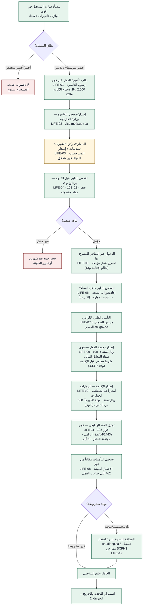

# الخريطة 1 — من تأشيرة العمل إلى هوية المقيم (المحور 4)

> الأساس: `docs/05-iqama-lifecycle.md` (LIFE-01..14) · تاريخ التوثيق: 2026-11-17

## ملاحظات الارتباط الحرجة (من LIFE-13)

| ماذا | يتطلب | الأساس |
|---|---|---|
| العمل داخل المملكة | تصريح إقامة | نظام الإقامة م12 |
| إصدار/تجديد الإقامة | رخصة عمل سارية | م/8 1415هـ + قرار 325 |
| الإقامة | فحص طبي لائق + تأمين ساري | الجوازات/الضمان الصحي |
| التأمينات | إنشاء العقد في قوى (إرسال تلقائي) | دليل توثيق العقود |
