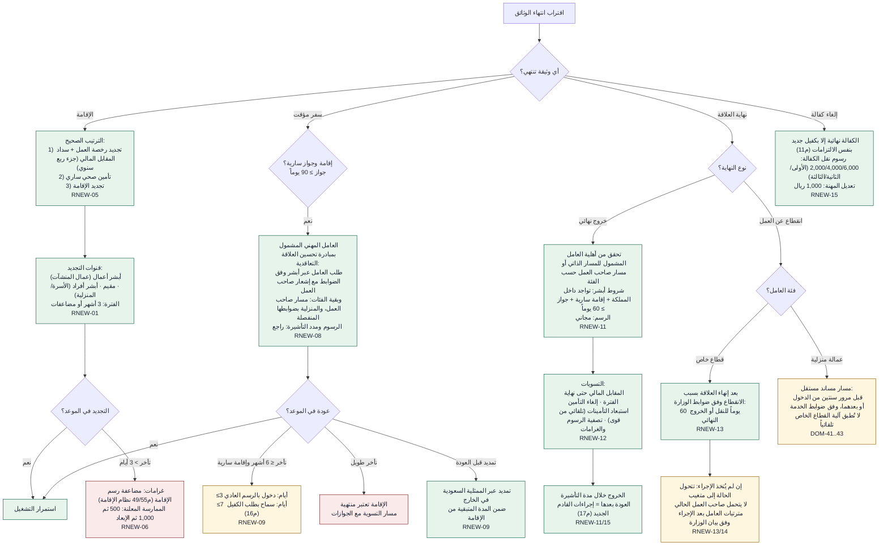

# الخريطة 2 — دورة التجديد والخروج والعودة والخروج النهائي (المحور 9)

> الأساس: `docs/10-renewal-exit.md` (RNEW-01..15) · تاريخ التحديث: 2026-11-20

## الترتيب الصحيح للتجديد (ملخص سطر واحد)
**رخصة عمل + سداد المقابل ← تأمين ساري ← تجديد الإقامة (3/6/9/12 شهراً) ← متزامناً: تأمينات تلقائية من قوى + تصاريح المهنة** — الأساس: م/8 1415هـ «لا تُمنح الإقامة ولا تُجدد إلا بعد رخصة العمل» + قرار 325.

## انذارات الأرقام (موسومة في الدليل)
- رسوم نقل الكفالة (2,000/4,000/6,000) و1,000 ريال لتعديل المهنة: من جدول رسوم الجوازات (أرشيف رسمي 2023) — **حداثتها في 2026 غير متحققة**، ويوجد تعارض مع خدمة قوى التي تصف تغيير المهنة «مجانية» (راجع `docs/09` PROF-xx).
- رقم غرامة التأخير 500/1,000: ممارسة معلنة للجوازات (ثانوي)؛ السند الأكيد م49/55 (مضاعفة الرسم).

## سند التصحيحات
- [مبادرة تحسين العلاقة التعاقدية، وزارة الموارد البشرية](https://www.hrsd.gov.sa/media-center/news/770957).
- [تحديث إجراءات الانقطاع للقطاع الخاص، وزارة الموارد البشرية](https://www.hrsd.gov.sa/media-center/news/1170537).
- ضوابط المنزلية ومصدر خدمة مساند: [الدليل المنزلي DOM-41..43](../docs/16-domestic-workers.md).
