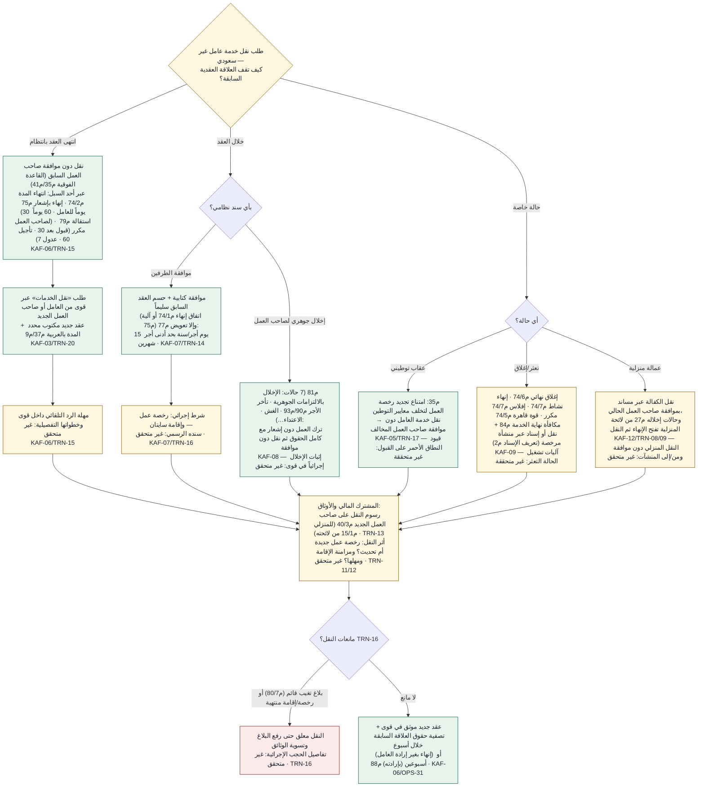

# الخريطة 3 — نقل الخدمات بين أصحاب العمل (المحوران 6-7)

> الأساس: `docs/07-kafala-transfer.md` (KAF-01..13) · `docs/08-transfer-scenarios.md` (TRN-01..20) · تاريخ التحديث: 2026-11-20

## مصفوفة السيناريوهات العشرة (TRN-01..10)

| # | السيناريو | الحكم | الأساس والحالة |
|---|---|---|---|
| 1 | فرد → مؤسسة | مشروط | الفرد صاحب عمل نصاً (م2)؛ التطبيق الإجرائي في قوى: غير متحقق |
| 2 | مؤسسة → مؤسسة | مسموح | المسار الأصيل (م41) · TRN-02 |
| 3 | مؤسسة → شركة | مسموح | لا فرق نظامياً (م2)؛ رقم فعالية نشط · TRN-03 |
| 4 | شركة → شركة | مسموح | الأشيع في السوق · TRN-04 |
| 5 | شركة → مؤسسة | مسموح | ذات شروط السيناريو 2 · TRN-05 |
| 6 | منشأة → فرد | غير متحقق | تشغيل غير المنزلية لدى الأفراد: غير متحقق · TRN-06 |
| 7 | منشأة → فردي (منزلي) | غير متحقق | يدخل منظومة لائحة العمالة المنزلية · TRN-07 |
| 8 | منزلية → منشأة | مشروط | مبدئياً بالموافقة (مساند)؛ الاستثناءات: غير متحققة · TRN-08 |
| 9 | منشأة → منزلية | غير متحقق | لا حظر صريح مثبت ولا سماح إجرائي · TRN-09 |
| 10 | منشأة → منشأة بنشاط مختلف | مسموح | القيد المهنة لا النشاط (م38) · TRN-10 |

## ارتباطات حرجة

| ماذا | يتطلب | الأساس |
|---|---|---|
| النقل عبر قوى | علاقة سابقة منتهية بانتظام أو موافقة/سند نظامي | م74/م75/م79 مكرر، م41 |
| الرسوم | على صاحب العمل الجديد (المبالغ: غير متحققة) | م40/3 |
| عقد المستقبل | مكتوب محدد المدة بالعربية موثق | م37/م9 |
| تسوية الحقوق | أسبوع/أسبوعين من انتهاء العلاقة | م88 |

## انذارات الأرقام (موسومة في الدليل)
- رسوم النقل 2,000/4,000/6,000 ريال حسب ترتيب النقل: مصدر ثانوي — **غير متحققة رسمياً**؛ الثابت نظاماً: تحميلها على صاحب العمل الجديد (م40/3)، ورسوم تغيير المهنة (م40/1) غير متحققة · TRN-13.
- إشعارات م75 (30/60 يوماً) وأجر مهلة الإشعار (م76): نص نظامي متحقق؛ مهلة رد قوى الإجرائية: غير متحققة · KAF-06.
- تعويض الإنهاء غير المشروع م77 (15 يوم أجر/سنة، حد أدنى أجر شهرين) يتشكل عند نقل عقد ساري دون سند.

## سند تصحيح مهلة التصفية
[نظام العمل المحدث، المادة 88](https://www.hrsd.gov.sa/sites/default/files/2025-11/labor-law.pdf). المادة 84 لحساب مكافأة نهاية الخدمة، وليست مهلة التصفية.
