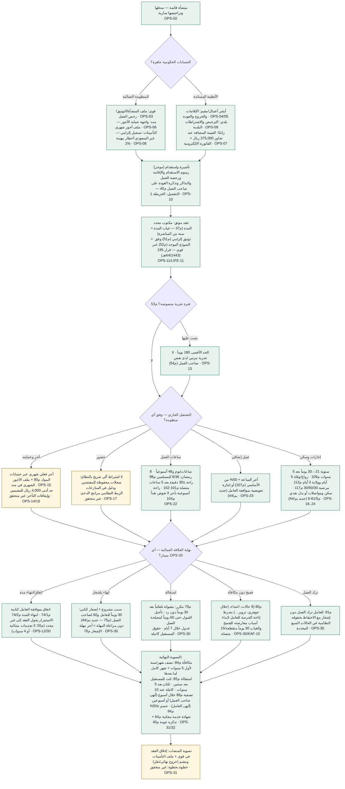

# الخريطة 4 — توظيف وتشغيل عامل في منشأة قائمة (المحور 11)

> الأساس: `docs/12-operations.md` (OPS-01..35) · تاريخ التحديث: 2026-11-20

## جدول الارتباطات الحرجة

| ماذا | يتطلب | الأساس |
|---|---|---|
| توثيق العقد | ملف قوى + النموذج الموحد + موافقة العامل | م51-52 + قرار 195 (LIFE-11) |
| حماية الأجور | حساب بنكي للعامل + ملف أجور شهري في مدد | م90/2 + OPS-06/15 |
| رخصة العمل والإقامة | سداد الرسوم والمقابل المالي (جزء ربع سنوي) | م40 + قرار 325 (OPS-14) |
| الإنهاء بإشعار | سبب مشروع + إشعار كتابي 30/60 يوماً | م75 (جديد بم/44) |

## انذارات الأرقام (موسومة في الدليل)
- 4,000 ريال (حد أدنى للمقيمين/إعفاء من المقابل المالي): تعارض مصادر ثانوية — **غير متحقق من نص رسمي** (OPS-14)؛ الثابت متحقق: رخصة العمل 100 ريال/سنة أو 25 ريالاً/3 أشهر + المقابل المالي 700/800 ريال بجزء ربع سنوي (قرار 325).
- إيقافات حماية الأجور (تأخر شهرين/ثلاثة، عتبة التزام 80%): مصدر ثانوي — **غير متحقق نصاً** (OPS-16).
- غرامات جدول المخالفات (500 حتى 500,000 ريال): من نسخ سابقة؛ النافذة 2026 (قرار وزاري 112377) ممسوح ضوئياً — **غير متحققة** (OPS-28)؛ الثابت م229: غرامة ≤100,000 ريال أو إغلاق 30 يوماً أو نهائي، تتضاعف بالتكرار.
- نسب التأمينات 21.5% (سعودي) و2% أخطار مهنية (غير سعودي): ثانوي متسق — غير متحقق من نص النظام (OPS-08).
- إلغاء المقابل المالي للمنشآت الصناعية (تقارير 12/2025 و10/2026): ثانوي — غير متحقق (OPS-14).

## سند التصحيحات
- [نظام العمل المحدث، المواد 61 و64 و79 مكرر و80 و81](https://www.hrsd.gov.sa/sites/default/files/2025-11/labor-law.pdf).
- [جدول تجزئة رسوم رخص العمل](https://www.hrsd.gov.sa/sites/default/files/2021-11/07032022.pdf).
